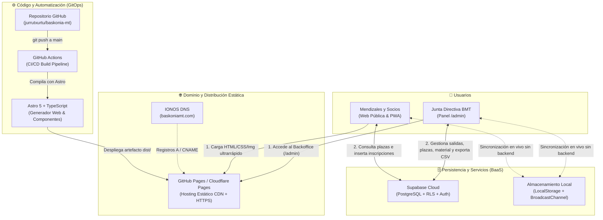

# Baskonia Mendi Taldea · Web & Backoffice

Plataforma web oficial y panel de administración (**Backoffice**) de **Baskonia Mendi Taldea** (Basauri · 1913), diseñada bajo una arquitectura *Jamstack / Serverless* de mantenimiento cero, bilingüe (Euskera / Castellano) y con soporte de aplicación instalable (PWA).adFSD

---

## 🏗️ Arquitectura Objetivo



---

## 🧩 Rol de cada elemento y tecnología

| Elemento / Tecnología | Rol dentro de la arquitectura |
| :--- | :--- |
| **[Astro](https://astro.build/) + TypeScript** | **Framework Web y Generador Estático (SSG).** Estructura la web en páginas (`/` y `/admin`), componentes reutilizables (`Modals.astro`), estilos limpios y módulos tipados de datos (`bmtDefaultData.ts`, `i18n.ts`), generando HTML estático ligero sin sobrecarga innecesaria en el navegador. |
| **GitHub (`jurrutxurtu/baskonia-mt`)** | **Fuente única de verdad del código y activos estáticos.** Almacena el código fuente, las fotografías históricas/anuales optimizadas (`public/img/`), el esquema SQL (`supabase/schema.sql`) y la definición del pipeline de despliegue. |
| **GitHub Actions (`deploy.yml`)** | **Pipeline CI/CD automatizado.** Ante cada `push` a la rama `main`, levanta un entorno Node.js limpio, instala dependencias (`npm ci`), compila el proyecto con Astro (`npm run build`) inyectando la ruta base y variables de entorno, y publica el artefacto resultante. |
| **GitHub Pages / Cloudflare Pages** | **Hosting Estático Global (CDN) y SSL.** Sirve los archivos estáticos compilados (`dist/`) con alta disponibilidad, coste 0 € y renovación automática de certificados HTTPS, eliminando la necesidad de mantener servidores PHP/Apache o actualizar plugins como en WordPress. |
| **Supabase (PostgreSQL + RLS)** | **Backend-as-a-Service (Base de datos en tiempo real).** Almacena los datos dinámicos que cambian sin necesidad de recompilar la web: salidas y cursos (`activities`), contador de plazas ocupadas, inscripciones de socios (`izena_emateak`), disponibilidad del material de invierno (`materials`), rutas de Wikiloc (`wikiloc_routes`) y ajustes del club (`site_settings`). |
| **Capa Híbrida (`bmtStore.ts`)** | **Adaptador de datos con almacenamiento local.** Abstrae el acceso a datos: si las credenciales de Supabase están configuradas, opera contra PostgreSQL en la nube; si no están definidas, persiste y sincroniza mediante `localStorage` y `BroadcastChannel`. |
| **jsPDF + PWA (`manifest.json` / `sw.js`)** | **Servicios en cliente.** Generación instantánea en el navegador de los resguardos en PDF para el simulador de licencias de la federación (EMF) y presupuestos del refugio de Iondokorta, además de instalación de la web como aplicación móvil/escritorio con caché offline. |
| **IONOS (`baskoniamt.com`)** | **Registrador del dominio y correo.** Mantiene la titularidad del dominio `baskoniamt.com` y sus registros de correo (`MX`), delegando únicamente el tráfico web (`A` / `CNAME`) hacia el CDN estático. |

---

## 📁 Estructura del repositorio

```text
baskoniamt/
├── .github/workflows/deploy.yml   # Pipeline CI/CD para publicación automática en GitHub Pages
├── public/
│   ├── img/                       # Activos gráficos organizados (aterpea, galeria 2025/2026, materiala, denda, docs)
│   ├── manifest.json              # Manifiesto Web App (PWA)
│   └── sw.js                      # Service Worker para soporte offline
├── src/
│   ├── components/
│   │   └── Modals.astro           # Modales informativos, simuladores de tarifas y formulario de inscripción
│   ├── data/
│   │   ├── bmtDefaultData.ts      # Modelo de datos tipado y semilla inicial bilingüe (EU/ES)
│   │   └── i18n.ts                # Diccionario de internacionalización Euskera <-> Castellano
│   ├── lib/
│   │   └── bmtStore.ts            # Cliente híbrido (Supabase Cloud / Sincronización Local en vivo)
│   ├── scripts/
│   │   ├── homeClient.ts          # Controlador cliente de la web pública
│   │   └── adminClient.ts         # Controlador cliente del Backoffice (/admin)
│   ├── styles/
│   │   └── bmt.css                # Sistema de diseño y estilos globales
│   └── pages/
│       ├── index.astro            # Portal público principal (/)
│       └── admin.astro            # Backoffice de gestión del club (/admin)
└── supabase/
    └── schema.sql                 # DDL de tablas e índices + Políticas Row Level Security (RLS)
```

---

## 🛠️ Desarrollo local

```bash
# Instalar dependencias
npm install

# Iniciar servidor de desarrollo en http://localhost:4321
npm run dev

# Generar build estático de producción en ./dist
npm run build
```
